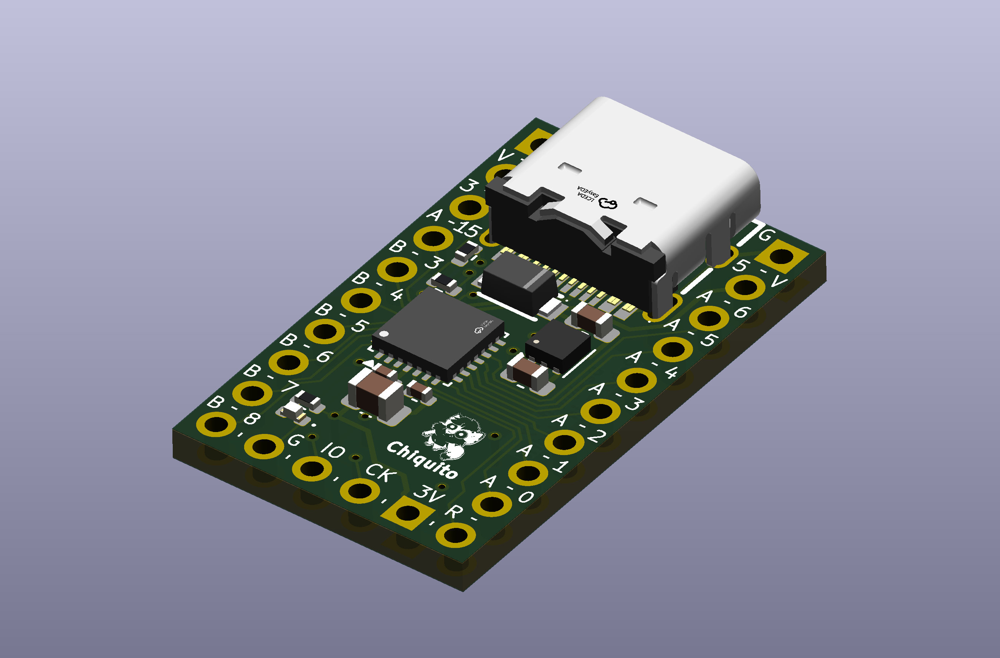
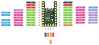

# Chiquito 🤏

Chiquito is a simple, small, development board for the STM32C071 processors.

The STM32C071 processors are the only ones in the STM32C0 line that has an
internal accurate 48 MHz crystal oscillator, that allows to run the processor
with USB capabilities without the need of an external crystal. This is great for
small projects where you're looking to reduce the BOM.

## Features

- Processor: STM32C071G8U6 ([Complete specs here](https://www.st.com/en/microcontrollers-microprocessors/stm32c071g8.html))
  - ARM Cortex-M0+ core running at 48 MHz.
  - 64 Kbytes RAM.
  - 24 Kbytes RAM.
  - Communication: USART, SPI, I2C.
  - Full USB 2.0 support in Host and Device mode, without external oscillator.
- Integrated voltage regulator from 5V to 3.3V, up to 1A.
- Direct VBUS pin, for USB connection detection.
- 5V pin for external power supply.
- 3V3 pin for external power supply, bypassing integrated voltage regulator.
- Exposed SWD debugging interface.
- Power-on LED.

## Fabrication

Production files are available in the [production](production/) folder.
Fabrication has been tested with JLCPCB, therefore it is the recommended way to
go.

Since JLCPCB prices are the same for 2 and 4 layer board, this design uses a 4
layer board where both inner layers are just ground planes, for better control
of the signal integrity and USB impedance matching. Other providers may price
you more for this number of layers.

Before sending to fabrication, always make sure that all the production files,
BOM and PCBA positioning files are correct and up-to-date. As a hobby project,
no responsability is taken for failures in the fabrication process or in the
behavior of the final board.

## Quick start

### First USB connection

By default, on the first connection, the device should boot into DFU mode.

If you don't have handy a ST-Link programmer and you're planning to use DFU as
your main way for uploading new firmware, you must use the
[STM32CubeProgrammer](https://www.st.com/en/development-tools/stm32cubeprog.html)
and set to 0 the nBOOT_SEL option **before** uploading any firmware, so you can
enter into DFU mode by just driving the BOOT0 pin low. Otherwise, after the
first firmware upload, you won't be able to access the DFU mode unless you own a
ST-Link programmer.

### Uploading new firmware

You may use either the STM32 DFU mode or an ST-link programmer to upload new
firmware:
 - By default, entering into DFU will require you to manually set the nBOOT0 pin
   to 1 using a ST-Link programmer, and then reboot the device. You may change
   this behavior by setting the nBOOT_SEL option to 0, so you can enter into DFU
   mode by just driving the BOOT0 pin low.
 
 - For using a ST-Link programmer, connect the it to the debugging pins located
   at the bottom of the board (`GND`, `SWDIO`, `SWDCLK` and `+3V3`).
